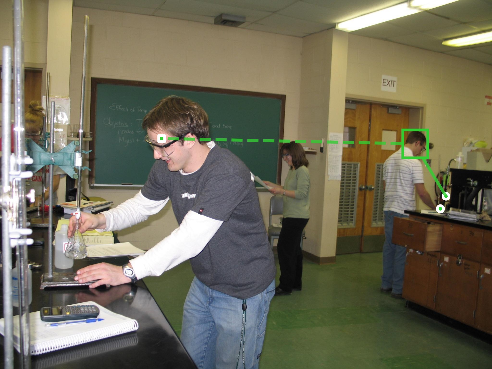
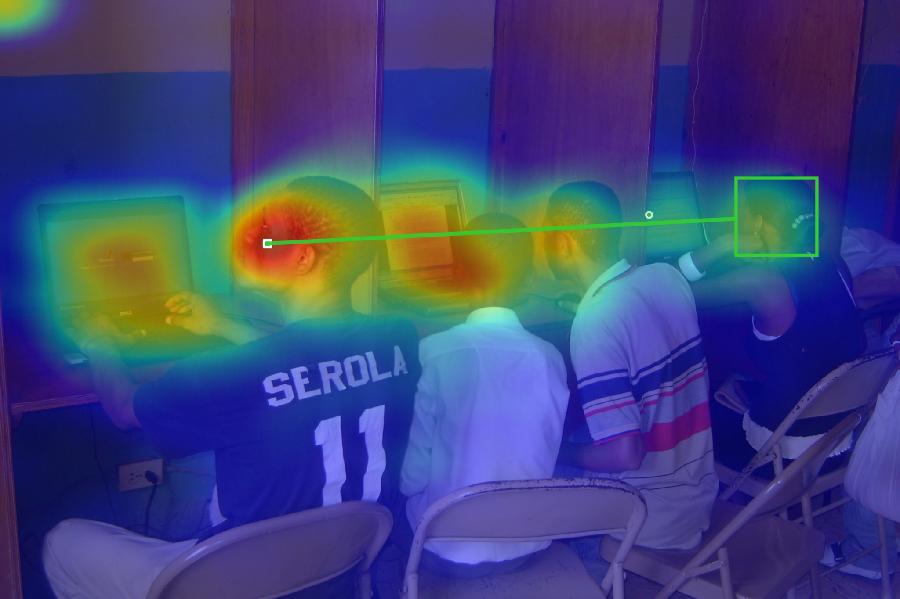
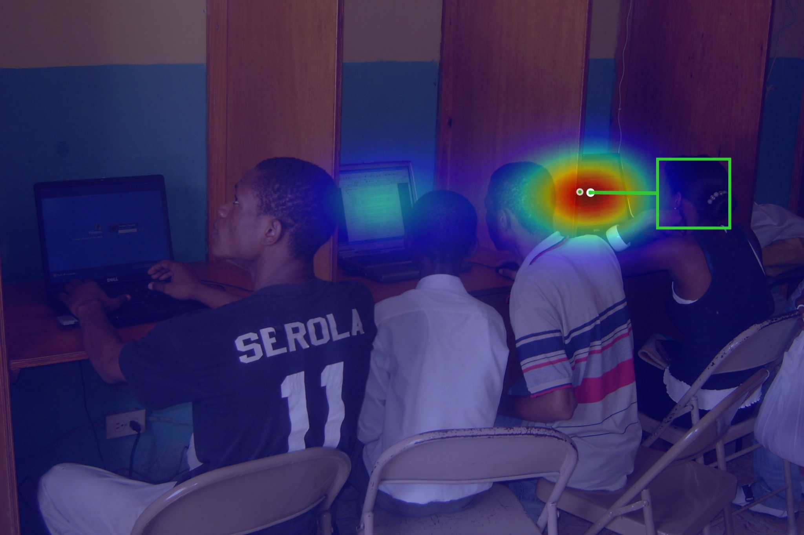

# TextGaze-IJCAI2026

**Official PyTorch implementation for "TextGaze: Prompting Gaze Target Estimation with Textual Scene Cues" (IJCAI-ECAI 2026)**

> TextGaze injects textual scene cues — dense, automatically generated scene captions —
> into a gaze target estimation model, resolving ambiguity in scenarios where visual
> appearance alone is misleading (e.g., *is this person looking at their own screen,
> or at the person next to them?*)

> [!WARNING]
> **🚧 This repository is still under construction.** Code and test-set annotations
> are available; checkpoints, training splits, and some docs are being added
> progressively — see the TODO list below..

<p align="center">
  
  <br>
  <em>Green box + dashed line: ground-truth gaze target. Textual scene cues let the model
  disambiguate who the person in the foreground is actually looking at.</em>
</p>

## 🔥 News

- **[2026-01]** TextGaze accepted to **IJCAI-ECAI 2026** (main track).
- **[2026-09]** Repository released: code, test-set annotations, and text-cue annotations.

> [!NOTE]
> The original paper contains a few typographical errors. A corrected version is available on arXiv: [arXiv:2607.10130](https://arxiv.org/abs/2607.10130). Please refer to the latest arXiv version. The corrections are typographical only and do not affect any experimental results or details.

## 🧩 Method

TextGaze builds on the GAZELLE gaze estimation architecture (DINOv2 backbone with a
vision-language fusion transformer) and adds a **textual cues branch**:

1. **Visual backbone**: DINOv2 (ViT-B / ViT-L) encodes the scene.
2. **Textual cues**: Qwen2.5-VL generates dense English scene captions; a BERT encoder
   embeds them (`*_Qwen_En` annotation variants carry these captions per head).
3. **Fusion**: a lightweight vision-language transformer fuses head features with text
   embeddings.
4. **Heads**: per-person gaze **heatmap** (64×64) + optional **in/out** of frame prediction.

The text branch requires no extra human annotation beyond the generated captions
and adds little inference overhead.

## 📊 Results (paper numbers)

| Benchmark | Model | AUC | Avg L2 | Min L2 / AP |
|---|---|---|---|---|
| GazeFollow | TextGaze ViT-L | **0.956** | 0.099 | 0.043 (MinL2) |
| GazeFollow | TextGaze ViT-B | 0.953 | 0.105 | 0.047 (MinL2) |
| VideoAttentionTarget | TextGaze ViT-L | 0.941 | 0.102 | 0.911 (AP) |
| VideoAttentionTarget | TextGaze ViT-B | 0.932 | 0.113 | 0.879 (AP) |
| ChildPlay (in-house) | TextGaze ViT-L | 0.950 | 0.111 | 0.996 (AP) |

See the paper for the full comparison tables against prior work.

## 📁 Repository Structure

```
TextGaze-IJCAI2026/
├── gazefuze/                  # Core package (model, backbone, dataloader, utils)
├── data_prep/                 # Dataset preprocessing incl. Qwen2.5-VL caption generation
├── scripts/
│   ├── train_gazefollow.py    # Training on GazeFollow
│   ├── train_vat.py           # Training on VideoAttentionTarget
│   ├── eval_childplay.py      # Evaluation (ChildPlay / VAT-style JSON annotations)
│   ├── eval_gooreal.py        # Evaluation (GazeOutsideReal)
│   └── pick_text.py           # Text-cue selection utilities
├── inference_demo.py          # Single-image quick-start demo
├── datasets/                  # Test-set annotations (+ Qwen_En text-cue variants)
├── models/                    # Checkpoint zoo (links)
├── experiments/               # Training-run layout reference
└── assets/                    # Qualitative results used in this README
```

## ⚙️ Setup

```bash
git clone https://github.com/idremo/TextGaze-IJCAI2026.git
cd TextGaze-IJCAI2026
pip install -r requirements.txt
```

Backbone weights are fetched automatically on first run
(DINOv2 via torch hub; `bert-base-uncased` via HuggingFace). The Qwen2.5-VL captioner
is only needed when *regenerating* text cues — the released `*_Qwen_En` annotations
already contain them.

## 🏋️ Training

```bash
# GazeFollow (ViT-B example)
python scripts/train_gazefollow.py --model gazelle_dinov2_vitb14 ...

# VideoAttentionTarget (with in/out head)
python scripts/train_vat.py --model gazelle_dinov2_vitb14_inout ...
```

See `python scripts/train_gazefollow.py --help` for all options. Training layouts and
logs follow the `experiments/` directory convention.

## 📈 Evaluation

```bash
# ChildPlay-style evaluation (JSON annotations + optional text cues)
python scripts/eval_childplay.py \
    --data_path  /path/to/childplay_Qwen_En/images \
    --model_name gazelle_dinov2_vitl14_inout \
    --ckpt_path  /path/to/checkpoint.pt \
    --use_text   True

# Disable the text branch for ablation (use_text False reproduces the "w/o cues" rows)
```

## 🚀 Quick Start (single image)

```python
# See inference_demo.py for a complete runnable example
import torch
from PIL import Image
from gazefuze.model import get_gazelle_model

model, transform = get_gazelle_model("gazelle_dinov2_vitl14")
model.load_gazelle_state_dict(torch.load("gf_vitl.pth", map_location="cpu", weights_only=True))
model.eval()

pred = model.forward({
    "images": transform(Image.open("scene.jpg").convert("RGB")).unsqueeze(0),
    "bboxes": [[[0.42, 0.13, 0.50, 0.39]]],          # one head bbox (x1, y1, x2, y2), normalized
    "texts":  ["Two people at desks; the left person gazes toward the right person."],
    "num_ppl_per_img": [1],
})
heatmap = pred["heatmap"][0][0]   # 64x64 gaze heatmap for head #0
```

Or run the file directly:

```bash
python inference_demo.py --image scene.jpg --bbox 0.42 0.13 0.50 0.39 \
    --text "Two people at desks; the left person gazes toward the right person." \
    --ckpt gf_vitl.pth --out overlay.jpg
```

## 🗂️ Data & Annotations

Test-set annotations (ChildPlay, GazeFollow-extended, VAT) and split lists
(GazeOutsideReal) are included in [`datasets/`](datasets/) — see
[`datasets/README.md`](datasets/README.md) for the **format specification**:

| Directory | Content |
|---|---|
| `datasets/{childplay,childplay_Qwen_En}/` | ChildPlay test split, per-frame CSV + `test_preprocessed.json` |
| `datasets/{gazefollow_extended,gazefollow_extended_Qwen_En}/` | GazeFollow(-extended) annotation releases + preprocessed JSON |
| `datasets/{videoattentiontarget,videoattentiontarget_Qwen_En}/` | VAT test annotations (per-sequence CSV + JSON) |
| `datasets/{gooreal,gooreal_Qwen_En}/` | GazeOutsideReal split lists |

`*_Qwen_En` variants carry the **generated textual scene cues** (per-head `text`
field) used by TextGaze. Images must be obtained from the original benchmark
distributions (links in `datasets/README.md`).

## 🖼️ Qualitative Results

Textual cues matter most when visual context alone is ambiguous — a person facing a
laptop may in fact be looking past it:

| Sample | w/o text cues (old model) | TextGaze (full model) |
|---|---|---|
| Classroom | peak on own screen ❌ | peak on the gazed-at person ✅ |

<p align="center">
  
  
  <br>
  <em>Left: baseline prediction. Right: TextGaze — the peak moves to the truly gazed-at person
  (green box = ground truth).</em>
</p>

More side-by-side comparisons: [`assets/gallery/`](assets/gallery/).

## 📌 Checkpoints

Checkpoint links are being prepared — see [`models/README.md`](models/README.md)
for the release table (GazeFollow / VAT, ViT-B / ViT-L, with in/out variants).

## 📚 Citation

If you find this work useful, please cite:

```bibtex
@inproceedings{she2026textgaze,
  title     = {TextGaze: Prompting Gaze Target Estimation with Textual Scene Cues},
  author    = {She, Junhui and others},
  booktitle = {Proceedings of the Thirty-Fifth International Joint Conference on
               Artificial Intelligence (IJCAI-ECAI 2026)},
  year      = {2026}
}
```

*(author list to be finalized)*

## 📄 License

This repository is released under the [Apache License 2.0](LICENSE).
Dataset annotations keep the licensing terms of their respective source benchmarks.
